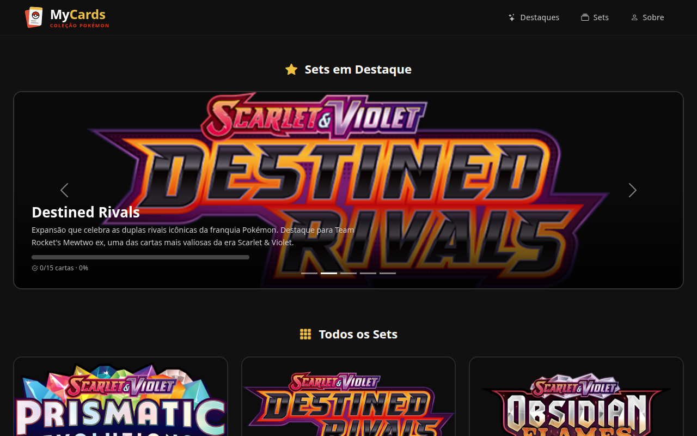

# MyCards

Site para acompanhar uma coleção de cartas Pokémon TCG: você navega pelos sets, abre um set e marca as cartas que já tem. O progresso de cada set fica salvo no navegador.

**Acesse:** https://gabriel-anjos-rocha.github.io/mycards/

## Funcionalidades

- Carrossel com os sets em destaque e o progresso de cada um
- Grid com todos os sets cadastrados
- Página de detalhes do set (`detalhes.html?id=...`) com informações gerais e a galeria de cartas
- Botão "Tenho esta!" para marcar cartas coletadas, salvo com `localStorage`
- Layout responsivo para desktop, tablet e celular

## Tecnologias

- HTML, CSS e JavaScript puro
- [Bootstrap 5](https://getbootstrap.com/) e [Bootstrap Icons](https://icons.getbootstrap.com/)
- Conteúdo montado dinamicamente a partir de uma estrutura JSON em `assets/js/app.js`

## Como rodar

Não precisa instalar nada: abra o `index.html` no navegador (ou use a extensão Live Server do VS Code).

## Sobre

Projeto desenvolvido por Gabriel dos Anjos Rocha para a disciplina de Desenvolvimento de Interfaces Web (DIW), Ciência da Computação, PUC Minas.

As imagens das cartas e dos logos dos sets vêm de [pokemontcg.io](https://pokemontcg.io/) e pertencem a The Pokémon Company / Nintendo. Este é um projeto de estudo, sem fins comerciais e sem afiliação oficial.
